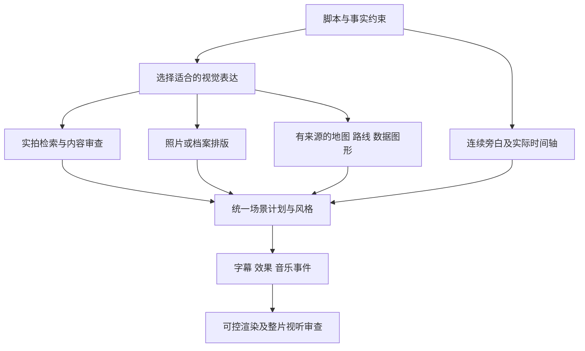

# 第12项：从 GoMotion 首页轨道与地图画面分析处理逻辑

日期：2026-11-11。目标：gomotionai.com。依据：[用户截图存档](gomotion-timeline-reference-2026-11-11.png)、[官网首页](https://gomotionai.com/)、[开发文档](https://gomotionai.com/developers)、[公开 OpenAPI](https://gomotionai.com/openapi.json)。没有登录或取得内部项目 JSON / 渲染日志；未运行新的 GoMotion 生成任务。

## 结论

这张截图最有价值的线索是：**GoMotion 展示的视觉片段按“信息如何表达”命名，音频、画面与效果具有不同边界。** 它支持一种产品判断：做同类产品需要规划多种视觉表达，并将旁白、来源素材、图形、字幕及音乐编排到统一时间轴上。仅做实拍检索和颜色匹配，表达能力不足。

但截图属于首页的演示区，不是后台执行记录。它不能证明五个独立 AI agent、具体渲染框架、真实工程轨道结构、素材主库，或“搜不到视频才生成图表”的分支。

## 1. V1：画面轨道暴露的是表达类型

| 可见标签 | 在截图中的含义 | 对实现的合理推断 | 仍需真实数据 |
|---|---|---|---|
| route diagram | 路线示意 | 可以把路径、节点和标签组成画面，按时间揭示 | 原地图 / 路线来源、历史事件路径及依据 |
| map reveal | 地图揭示；播放头落在该区间，右上为红色区域地图 | 地图基底、区域遮罩、高亮边界、文字和镜头运动可分别控制 | 地理轮廓、时点、实际控制区域及许可 |
| evidence board | 证据板 | 将档案照片、文档和短注释排版，再按旁白展示 | 可追溯档案或文档、作者、许可、事实关系 |
| donut chart | 环形图 | 数值、分类、颜色与标签是图形参数，可用通用渲染模板 | 真实统计口径、数值、单位、日期及数据来源 |
| bullet panel | 要点面板 | 用结构化文本、排版和逐项出现承载摘要 | 与原文一致的要点，不补造事实 |

这些名称更像“场景应该采用什么表达方式”，不像素材库视频文件名。这使**结构化场景规划 + 可控渲染**成为合理架构候选；不能据此认定它实际上使用某个模板引擎，或认定这些标签就是后台枚举。

官网同时说明实拍与 motion graphics，并点名文字、计数器和地图揭示等表现方式，为其混合表达能力补充了官方声明。[首页说明](https://gomotionai.com/)

## 2. 右上地图：哪些层可以独立控制

截图可见深色地图基底、红色区域、明亮边界、低对比度文字、底部字幕。与轨道的 map reveal 标签放在一起，可以提出以下渲染假设：

1. 读取有来源的地理底图和区域形状。
2. 按当前脚本实体与时点选择区域，确定高亮、标签及镜头范围。
3. 在地图之上合成颜色、边界、文字、字幕和动画。
4. 以成片的统一字体、色板和节奏输出。

这是**实现推断**。单帧截图没有给出动画帧序列，不能证明它究竟用了 SVG、Canvas、WebGL、预渲染地图视频或其他方法；也不能排除其中有 AI 生成的位图基底。

地图中的现代形状或文字视觉效果也不能当成1949年实际控制范围的事实证据。要复刻历史地图，必须另外取得对应时点的数据与来源；不能为了填满画面随意涂一整块区域。

## 3. A1：旁白与画面的边界不必一一对应

截图 A1 有三个较长的橙色块，V1 有五个视觉块；音频块跨过视觉切点。这在演示层面表达了：**旁白段落与剪辑镜头是两种不同的单元。** 统一音色的叙述可以连续进行，画面在其中切换。

不能据此证明后台只生成一个 WAV：同一音色的多个音频文件也能连续拼接；橙色波形是否由真实音频计算同样未知。对我们的要求仍是全片声音一致、连续、没有切镜重启，当前整篇单音轨方案与此相符。

## 4. FX：效果与配乐按自己的区间编排

截图显示 karaoke、zoom、counter、score—war drums。可以分别解释为逐词字幕 / 高亮、缩放、数字变化、背景配乐。它们不必与某个 V1 片段完全等长。

这支持“场景之外还需时间化的效果事件”这一设计假设。不过 FX 一行同时放效果和音乐更像紧凑展示，不能当成完整工程的实际音频总线。配乐和音效究竟是独立轨道、合成在素材里，还是导出时统一混音，仍未知。

官网开发参数分别提供 `animations`、`background`、`subtitles` 和音乐选项；这确认这些能力可被分别配置，**没有公开逐层渲染计划**。[创建接口](https://gomotionai.com/developers)

## 5. 截图中的两个证据限制

- 左侧被高亮的句子讲岸上炮火，右上字幕却在讲军队已占领北方。一个截图不能证明这套展示按句精确同步；不同区域可能独立演示，也可能处在不同状态，不能把高亮当作真实强制对齐日志。
- Voice Deneb、Voice actor / Asset manager / Sound designer 等名称说明用户可见的角色与音色展示，不足以确认供应商、模型或真实多 agent 架构。声音归属仍需具体 API / 官方供应商证据。

## 6. 对 MVP 的具体启发

建议的后台架构是假设方案，**不是还原出的 GoMotion 源码**：

核心分工：模型负责理解旁白、选择表达类型、选择来源并给参数；数据与素材来源提供事实基底；渲染器负责一致的画幅、字体、图形、动画和时间控制。这通常比让生成式视频模型每次重新画一个精确地图或图表更可控，但本轮没有做成本或质量对照实验。

### 仍须遵守的现有约束

- 新增第11项要求真实非视频来源；地图、照片、文档或图表也必须保存来源、许可和事实依据。没有数据时不能编造百分比、路线或历史控制区域。
- 动态表达可以按语义主动选择；“实拍搜索失败后的补片”只是其中一种入口。这是产品建议，目标 SaaS 的真实触发机制仍未知。
- 第10项仍只调研：本轮没有改脚本拆分策略，也没有把旁白、检索单元、剪辑单元强行改成新的切法。
- 用户操作保持粘贴脚本后直接生成；表达类型、过渡、字幕和混音在后台决定，不新增多轨编辑负担。
- 当前应用的 v2 来源图标注只是上述表达能力的一小部分，不应宣称已经支持路线、证据板、环形图全部能力。

## 验收结论

已完成截图逐项解读、官方交叉核对、证据等级与 MVP 建议；没有获得目标内部时间轴或引擎证据。要升级成实现验证，至少还需要真实项目 JSON / 脱敏网络响应，或能观察地图、标签、旁白如何改变的实际编辑过程。本项为调研交付，不代表这些图形类型已在本地实现。
