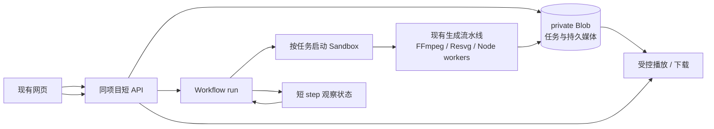

# GoMotion 在同一 Vercel 项目异步制作视频的最小迁移

调研日期：2026-11-11。范围为只读代码检查、官方文档与两项只读 CLI 查询；没有部署、创建资源、修改项目设置、调用模型或终止任务。

## 结论与已核实的账号边界

当前项目可以继续使用同一个 Vercel 项目提供网页和 API，但完整生成不能把现有 `createProductionManager` 的内存 Map、`setInterval` 和本地 `jobs.json` 原样放进 API Function。

**建议在保持当前项目 Root Directory 的前提下，采用 Workflow 调度 + 按任务启动的 Sandbox 执行现有媒体流水线 + private Blob 保存任务与媒体。** 这是本文建议的迁移方案，尚未实施或进行云端端到端验证。它保留现有 FFmpeg / Resvg / worker 的主体算法，将云迁移主要限制在任务启动、状态存取与文件适配层。

如果用户愿意调整项目根目录且需要持续接单，Daemon + private Blob 更接近现有常驻泵，改动也可能更少；但目前官方后台任务指南明确要求 Daemon 项目的 Root Directory 为仓库根目录，当前配置不满足，不能直接承诺加一段配置即可上线。[Vercel 后台任务指南](https://vercel.com/kb/guide/background-workers-on-vercel)

已实际执行的只读检查：

| 查询 | 结果 |
|---|---|
| `vercel project inspect gomotion-mvp --scope signflow2 --non-interactive` | 项目存在；Root Directory 为 `outputs/gomotion-mvp`；Vite；Node 26.x；Sandbox 默认区域 `iad1` |
| `vercel blob list-stores --all --json --scope signflow2 --non-interactive` | **`stores: []`**，该 scope 当前没有可复用 Blob store |
| 本地 CLI | 59.5.0 |

因此，“已登录 Vercel / 已 link / 有 OIDC”不等于完整生成所需持久资源已经存在。当前至少缺少一个已创建、连接到此项目的 Blob store。没有创建 Sandbox 做权限探针，故只能确认项目有 Sandbox 设置，**不能确认当前套餐余量、创建权限或 40 分钟运行已实测可用**。环境变量为空是父任务已核实的状态；本轮没有读取或输出任何密钥。

## 各产品在本项目中的作用

| 能力 | 能做什么 | 本项目的使用边界 |
|---|---|---|
| Functions / `waitUntil` | 处理短 API 请求，响应后继续有限工作 | Hobby 最长 300 秒；Pro / Enterprise 通常最长 800 秒，特定运行时 beta 可到 1800 秒。40 分钟单任务超过这些上限；不能把响应后本地进程当持久后台。[时限](https://vercel.com/docs/functions/limitations) |
| Container Runtime / Services | 安装 FFmpeg 等依赖，同项目组合多个服务 | 普通 container 仍按 Function 生命周期运行、闲置缩容，不能由此获得常驻任务泵。[Container Runtime](https://vercel.com/docs/functions/runtimes/container) |
| Workflow | 持久保存步骤结果、等待与恢复 | run 总时长不限，但单个 step 仍受 Function 时限限制；因此 40 分钟 FFmpeg 不能直接包进一个 step。[Workflow 限制](https://vercel.com/docs/workflows/pricing) |
| Queues | 持久消息、重投递、消费并发控制 | push consumer 仍受 Function 时限；poll 可由 Daemon 消费。消息最多保留 7 天，不能充当长期项目库。[Queues 限制](https://vercel.com/docs/queues/pricing) |
| Sandbox | Linux 环境执行 FFmpeg / Node worker | 单 session Hobby 45 分钟，Pro / Enterprise 24 小时；默认仅 5 分钟，必须显式配置。40 分钟制作还要留初始化及上传时间，Hobby 余量很窄。[Sandbox 配额](https://vercel.com/docs/sandbox/pricing) |
| Daemons | 持续运行队列消费者或视频 worker | public beta、仅 production，无自动扩缩容、无持久本地磁盘；适合持续工作，但当前项目根目录有额外迁移前提。[Daemons](https://vercel.com/docs/daemons) |
| Blob | 持久文件、项目快照、成片与来源凭据 | private store 可保存任务 JSON。当前 SDK 有条件写和一致性读，小规模 MVP 可以先不增加数据库。[条件写](https://vercel.com/docs/vercel-blob)、[SDK](https://vercel.com/docs/vercel-blob/using-blob-sdk) |

Workflow 的结束数据不能作为永久项目库：当前 Hobby / Pro / Enterprise 的已结束 run payload 保证可读期分别为 1 / 7 / 30 天。任务列表、项目恢复与成片引用仍须写入自己的持久存储。[Workflow 数据保留](https://vercel.com/docs/workflows/retention)

## 推荐方案：Workflow + Sandbox + private Blob

下面是实施设计，区别于已经验证的官方能力。

1. **提交先持久化。** `POST /api/productions` 验证项目及用户，按 `environment/owner/projectId/submissionId` 创建固定路径的任务 JSON，再调用 `start()`，把 `runId` 存回任务并返回 202。禁止在该请求里等待成片。首次启动与写回之间必须可恢复：对相同 submission 重试时查已存的 run/launch 状态，并有一个定期 reconciliation 流程处理“任务已写、run 尚未启动”的窗口，避免静默卡队列。
2. **Workflow 只做调度。** 一个短 step 创建或取得该 attempt 的命名 Sandbox，启动 `node worker/run-one.mjs` 的 detached command；保存 sandbox name、session ID、command ID、attempt、执行版本。后续 step 短时间查询，期间用 `sleep()` 挂起。不能 `await command.wait()` 一直等 40 分钟。SDK 支持 detached command 和后续查询，但 command ID 属于原 session，恢复后不能把旧 ID 当作新 VM 的进程。[Sandbox SDK](https://vercel.com/docs/sandbox/sdk-reference)
3. **现有 execute 改为单任务入口。** 从 `productions.mjs` 分出 `executeProduction(task, adapters)`，去掉云执行中的常驻 `pump()`；保留规划、检索、旁白、图形、渲染和审片顺序。已有 `onCheckpoint` 转为上传 JSON 与文件引用。Sandbox 内的 Map 与 `/tmp` 只作本次计算缓存。
4. **每个可恢复阶段先上传，再提交快照。** 音频、合格候选、来源原图/解码图、图形补片、最终 MP4、SRT、`sources.json` 都使用不可变对象路径并保留 SHA-256。确认上传成功后，才让 task checkpoint 引用该对象。重启从 Blob 重新水合到当前临时路径；禁止把旧机器绝对路径当持久地址。最终“done”须同时满足成片上传成功、完整覆盖、视听审查通过。
5. **UI 继续轮询短 API。** `GET /api/productions` 从任务对象读取状态，支持现有 cursor 语义；`GET /api/productions/:id` 回传进度和结果引用。单用户、最多约 25 个保留任务时，可以先用 Blob prefix 列举与 JSON 读取，避免立即引入数据库。多用户、高吞吐、复杂筛选或审计需求出现后，再迁移任务表到 Marketplace 数据库。
6. **取消必须跨进程。** 取消 API 持久写 `cancelRequestedAt`。Worker 定时读取并触发原有 AbortController，Workflow 也同步处理超时/取消并停止当前 Sandbox session。任务不能只在 API Function 的内存对象上执行 `controller.abort()`。启动/重试用租约及 attempt fencing，旧 worker 丧失租约后不能发布成片或覆盖新 attempt。
7. **先做恢复而后标成可用。** 强制结束执行进程、重新部署、重复提交、取消、源图片被改、上传失败等场景都必须从持久快照恢复，且不会重复调用已确认完成的外部步骤。外部 API 不能天然保证 exactly once：请求已成功而 checkpoint 尚未写入时仍可能重试，需按提供方支持的幂等键处理或明确记录可能的重复成本。

### 小规模任务存储的具体做法

任务对象可包含 `id / owner / inputHash / status / phase / progress / updatedAt / runId / sandbox / attempt / leaseOwner / leaseUntil / cancelRequestedAt / checkpointRefs / exportRefs / errorCode`。密钥不放入任务 JSON。

用 `get(..., { access:'private', useCache:false })` 读取最新任务和 ETag；状态更新用 `put(..., { access:'private', allowOverwrite:true, ifMatch:etag })`。冲突时重新读取并只合并本操作拥有的字段，不能把用户刚写的取消状态覆盖掉。CAS 抢租约、心跳续租和 attempt fencing 必须有并发回归；这是一种需要实现与验证的对象存储任务模型，并非 Blob 自动提供的任务数据库。

媒体保持不可变，任务 JSON 才覆盖；API 必须检验 owner，private Blob 服务凭据不能下发浏览器。大文件走受控直传 / presigned URL，不能经过普通 Function 的 4.5MB 请求体。现有 `handleUpload` 客户端 token 方式仍需要静态 RW token；如采用纯 OIDC，选支持 OIDC 的 `handleUploadPresigned` 路线。[Blob SDK 身份与上传说明](https://vercel.com/docs/vercel-blob/using-blob-sdk)

### Sandbox 内的权限不能自动继承

控制面的 Vercel Function 可用自己的运行时 OIDC 调用 Sandbox SDK，不需要用户再给它一个永久 Vercel API token。[Sandbox 身份说明](https://vercel.com/docs/sandbox/concepts/authentication)

但这不意味着 VM 内执行的 worker 自动拿到 Blob、模型或素材源权限。最小实现可以让控制面给本任务签发限时、限定 task/attempt/path prefix 的能力：Worker 通过经验证的短 API 申请 presigned 读写 URL，直接上传媒体，再提交引用与哈希。这样不必把整个 Blob store 的永久 RW token 交给 worker。模型与素材源凭据仍须由项目配置或用户授权提供，OIDC 不会自动补齐 Gemini / Pixabay / Coverr key。

Sandbox 现在默认可持久化文件系统快照，但这不能恢复已经退出的 Node 进程；本方案仍以 Blob checkpoint 为业务真相。可选 snapshot / Drive 只用于减少依赖安装或文件重新下载，必须单列存储和生命周期成本。[Sandbox 持久化](https://vercel.com/docs/sandbox/concepts/persistent-sandboxes)

## 更贴近现有代码的替代：Daemon + private Blob

如果确认可以调整 Root Directory，并接受常驻资源开销，可在同项目添加一个 Linux `amd64` Daemon。由它直接轮询持久任务 JSON，使用同样的 CAS 租约领取工作；这样最小版本连 Queues / Workflow 都不必强制增加。已有 task loop 可保留为 worker 实现，API 则只负责持久写任务、读进度及写取消请求。

后续任务变多时加 Vercel Queues poll mode，消息仅包含 `jobId / attempt / inputRef`。必须定期续租、处理至少一次投递，先提交持久结果后才 acknowledge；队列 TTL 到期不能导致项目丢失，任务库仍应能扫描并补发。推送消费模式不能绕开 40 分钟限制。

Daemon 收到 `SIGTERM` 时停止接单，上传已有 checkpoint、释放租约并退出；仅设置长 shutdown grace 不能替代崩溃恢复。Daemon 的 OIDC 在轮转文件中，由 `@vercel/oidc` 4+ 按每次操作读取最新 token，不能启动时读取一次后长期缓存。API Function 的 Blob 访问则优先让 SDK 自动处理当前身份。[Daemon 环境与 OIDC](https://vercel.com/docs/daemons)、[OIDC 文件轮转](https://vercel.com/docs/oidc)

Hobby 的常驻配额不适合宣称整月稳定在线：例如 2GiB worker 全天运行约 9 天就耗尽 420 GB-hours，此外还有 5 CPU-hours/月；耗尽后会停止。Pro 可按量计费，但套餐及用户账单授权本轮未核实。[Daemon 配额](https://vercel.com/docs/daemons/limits)

## 代码层面的确定阻塞

| 当前代码 / 配置 | 迁移必须处理 |
|---|---|
| `productions.mjs` 的 Map、全局 `active`、2 秒 interval、磁盘 `jobs.json` | 换成持久任务对象、租约、跨进程取消；多实例不能仅靠本地 busy 判断 |
| `sources.mjs` / playback / narration 的进程内目录与缓存 | 将可恢复的资产与文件引用持久化；进程内缓存只作加速 |
| source receipt 的 `localPath` / `decodedPath` | 增加 Blob object ref；每个运行位置重新水合并核对原 SHA-256，许可与 contentReview 一起保存 |
| 中文图形字体 | 已增加 `MOTION_FONT_FILE` / `MOTION_FONT_FAMILY` / `MOTION_SYSTEM_FONTS`，Docker 配置 Linux Noto CJK 与字幕字体目录；Linux 容器尚未实际运行，仍须验证字体可读、Resvg 字形和 ASS 字幕渲染 |
| Resvg 当前在本机安装的原生包 | 在 Linux amd64 镜像中重新安装锁定依赖，不能上传 Darwin arm64 的 node_modules |
| 依赖系统 `ffmpeg` / `ffprobe` 与 ASS 字幕 | 镜像显式安装含 libx264、libass 的构建并做短本地验收；不能假设 Node 26 Function 自带 |
| 现 Vite 是静态构建 + 原生 API | Workflow 需编译集成；官方 Vite 路线是 `nitro()` + `workflow()` 及 Nitro server routes，不能只加 `"use workflow"` 字符串。[Vite 接入指南](https://workflow-sdk.dev/docs/getting-started/vite) |
| 40 分钟执行上限 | Hobby Sandbox 的 45 分钟包括环境启动与文件收尾；需预制依赖环境、分阶段 checkpoint 或使用更长套餐 session，不能承诺任意 40 分钟任务都能一次完成 |

## 用户明确需要启用的资源

| 资源 | 推荐方案是否必需 | 当前状态 / 操作边界 |
|---|---|---|
| 一个 **private Blob store**，连到 gomotion-mvp Production | 必需 | CLI 实测无 store；必须创建并连接，SDK 才有 `BLOB_STORE_ID` 与对应访问范围。Preview / Development 是否连接应分别决定 |
| Workflow 运行与 SDK 构建集成 | 必需 | 属于部署与按量使用能力；本轮未增加代码或运行实例 |
| Sandbox 使用配额与预制执行环境 | 必需 | 有 `iad1` 默认配置；未创建 VM 或验证剩余配额。会产生运行/存储/传输用量 |
| 模型和素材源连接 | 必需 | OIDC 不替代这些 key；需要服务端安全配置才能自动后台续跑 |
| 独立数据库 | 第一版非必需 | 小量可先用 private Blob CAS；增长后建议任务表 + Blob 媒体 |
| Queues / Daemon | 推荐方案不必需 | 改用持续 worker 时再开；Daemon 还涉及根目录与常驻成本 |

Blob 的读取与写入权限来自“项目 / 环境已经连接该 store”及运行身份；Vercel CLI 登录只证明当前用户能执行已成功的只读操作。本轮没有测试创建权限，也没有授权自己启用任何计费资源。**不能确认完全使用现有资源即可交付完整生成，因为实际缺少持久存储，且 provider 凭据与运行套餐余量尚未就绪。**

## 实施与验收顺序

1. 父任务先交付原生 API 与声音试听的 404 修复，独立验收；这不会自动启用视频后台。
2. 为资源开通准备具体配置清单，确认用户选择的套餐 / 区域 / 生命周期及是否允许发生相关用量。
3. 用不调用模型的短 fixture 验证 Blob create/read/CAS、Workflow start/status/cancel、Sandbox detached 执行、输出上传与私有下载。
4. 验证断网、强制终止、重复提交、重部署和租约过期恢复，再跑一条真实短脚本，记录完整耗时与各项费用。
5. 有真实来源图片 fallback 的项目通过来源、图像哈希、实际视听检查后，才开放完整生成；最后用实际长任务验证更长时长，不从短样片线性外推。

本轮迁移调研没有创建或更改线上资源。播放取消测试已恢复到原跟踪路径 `server/playback-cancellation.test.mjs`；当前实现已使用共享操作订阅隔离，原 3 项取消用例本地通过。该取消机制仍须由持久任务模型向跨进程 worker 传递，不能替代上文的跨进程取消设计。
